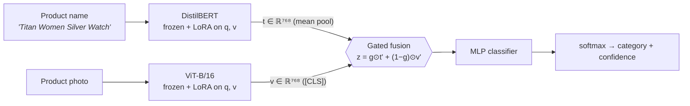
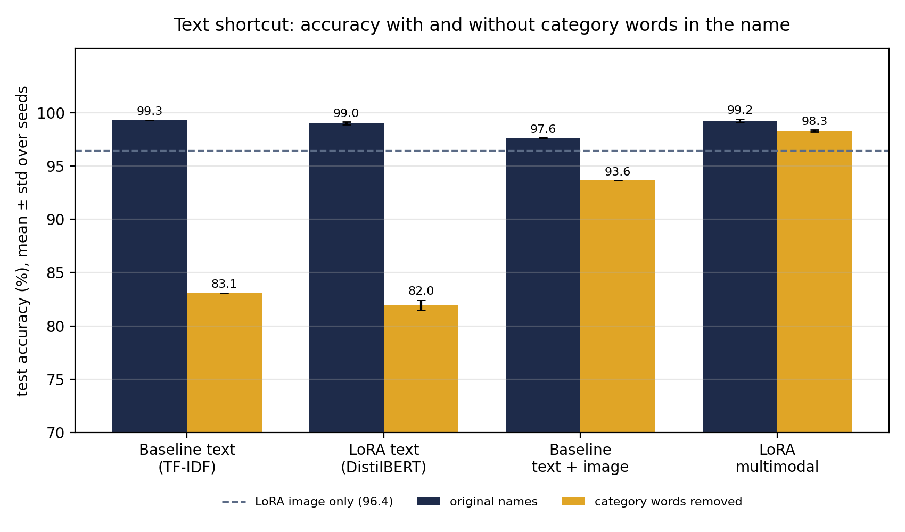

# 🏷️ Multimodal Product Classification with LoRA

Classify e-commerce products into catalogue categories from **their name, their photo, or both**, using a pretrained **DistilBERT** (text) and **Vision Transformer** (image) fine-tuned with **LoRA**, a gated fusion layer, and a professional **Streamlit** app. A classical **TF-IDF + Logistic Regression** baseline is trained on the identical split so the deep model has to earn its complexity.



| | |
|---|---|
| **Dataset** | [`ashraq/fashion-product-images-small`](https://huggingface.co/datasets/ashraq/fashion-product-images-small): ≈44k real products (Kaggle *Fashion Product Images (Small)*) |
| **Target** | `subCategory` (Topwear, Shoes, Watches, Bags, …). Classes with < 300 items dropped, large classes capped at 1,500 |
| **Text model** | `distilbert-base-uncased` (swap for `bert-base-uncased` with `--text-model`) |
| **Image model** | `google/vit-base-patch16-224-in21k` |
| **Trainable params** | **1.89 M of 154 M (1.23 %)**: 0.44 M LoRA + 1.45 M fusion/head |
| **Checkpoint size** | ≈ 7.6 MB (only trainable weights) vs ≈ 616 MB for the full model |

**Headline result:** on standard product names, adding the photo looks useless (every text model scores about 99%). Delete the category words from the names and the picture changes: text-only accuracy drops to **82%**, while the multimodal model holds **98.3%**. The image was doing real work all along; the shortcut in the names was hiding it. Details in [Results](#5-results).

All numbers in this README come from real training runs (3 seeds per LoRA model, same fixed test set of 2,739 products) and are stored in `outputs/`.

---

## 1. Project structure

```
multimodal-product-classifier/
├── app/
│   ├── streamlit_app.py        # web app: classify · performance · how it works
│   └── ui_components.py        # CSS, the prediction "tag", Plotly charts
├── scripts/                    # the things you run, in order
│   ├── prepare_data.py         # 1. download, filter, stratified split, EDA plots
│   ├── train.py                # 2. LoRA fine-tuning + automatic test evaluation
│   ├── train_baseline.py       # 3. TF-IDF / colour-histogram + Logistic Regression
│   ├── compare_models.py       # 4. comparison table + chart
│   ├── evaluate.py             #    re-evaluate any checkpoint
│   ├── predict.py              #    classify one product from the terminal
│   ├── robustness.py           # E2: missing / damaged inputs
│   └── paper_stats.py          # E3: seeds, McNemar, bootstrap CIs, paper tables
├── notebooks/
│   └── paper_experiments_colab.ipynb   # runs E1–E3 on a free Colab GPU
├── src/                        # the reusable library
│   ├── config.py               # ALL hyperparameters in one dataclass
│   ├── utils.py                # seed, device, logging, json, parameter counts
│   ├── data/
│   │   ├── dataset_loader.py   # HF download, class filtering, stratified split
│   │   ├── preprocessing.py    # text cleaning, image transforms
│   │   ├── keywords.py         # E1 category-word masking, E2 word drop
│   │   └── dataset.py          # PyTorch Dataset, collator, DataLoaders
│   ├── models/
│   │   ├── lora.py             # PEFT LoRA wrapper (with the maths)
│   │   ├── encoders.py         # TextEncoder (mean pool), ImageEncoder ([CLS])
│   │   ├── fusion.py           # GatedFusion, ConcatFusion
│   │   └── multimodal_model.py # full model + compact checkpoint save/load
│   ├── training/trainer.py     # AdamW, warm-up, AMP, clipping, early stopping
│   ├── evaluation/
│   │   ├── metrics.py          # accuracy/P/R/F1, confusion matrix, plots
│   │   ├── evaluator.py        # test-set evaluation + saved per-product predictions
│   │   └── statistics.py       # McNemar, Holm correction, bootstrap CI
│   ├── baseline/traditional_ml.py
│   └── inference/predictor.py  # ProductClassifier.predict(text, image)
├── tests/test_pipeline.py      # offline smoke tests with tiny random models
├── data/                       # created at runtime (raw cache + split files)
├── outputs/                    # created at runtime (checkpoints, metrics, figures)
├── .streamlit/config.toml      # app theme
├── .vscode/launch.json         # one-click run configs for every step
├── requirements.txt
└── README.md
```

How the files connect: every script adds the project root to `sys.path` and imports from `src`, so they run identically from the terminal, from VS Code's ▶ button, or from `launch.json`.

---

## 2. Setup

Requires **Python 3.10–3.12**. A CUDA GPU is strongly recommended for training (a free Google Colab T4 works). CPU is fine for the baseline, the app and quick experiments.

```bash
# 1) open the folder in VS Code, then a terminal (Ctrl+`)
cd multimodal-product-classifier

# 2) create and activate a virtual environment
python -m venv .venv
# Windows (PowerShell):
.venv\Scripts\Activate.ps1
# macOS / Linux:
source .venv/bin/activate

# 3) GPU only: install the CUDA build of PyTorch first (pick your CUDA version at pytorch.org)
pip install torch torchvision --index-url https://download.pytorch.org/whl/cu121

# 4) everything else
pip install -r requirements.txt

# 5) sanity check: runs in seconds, no downloads
python -m pytest tests -q
```

In VS Code, press `Ctrl+Shift+P` → **Python: Select Interpreter** → choose `.venv`.

---

## 3. Run the project (in order)

| Step | Command | What you get |
|---|---|---|
| 1 | `python scripts/prepare_data.py` | ~270 MB download (once), `data/processed/splits.json`, `label_map.json`, class-distribution and sample-grid plots |
| 2 | `python scripts/train.py` | `outputs/checkpoints/lora_multimodal.pt`, training curves, test metrics + confusion matrix |
| 2b | `python scripts/train.py --mode text`<br>`python scripts/train.py --mode image` | Ablations: what each modality contributes alone |
| 3 | `python scripts/train_baseline.py` | Three classical baselines (text, image, both) on the same split |
| 4 | `python scripts/compare_models.py` | `model_comparison.csv / .md / .png` |
| 5 | `streamlit run app/streamlit_app.py` | The web app at http://localhost:8501 |

Every step is also in **Run and Debug** (`Ctrl+Shift+D`) as a ready-made configuration.

**Classify from the terminal**

```bash
python scripts/predict.py --text "Fastrack Men Black Analog Watch" --image my_watch.jpg
python scripts/predict.py --text "Lakme Absolute Lip Gloss"      # name only
python scripts/predict.py --image my_bag.jpg                      # photo only
```

**No GPU? Quick experiment on CPU**

```bash
python scripts/train.py --max-train-samples 1500 --epochs 1 --num-workers 0
```
This trains on a subset (the test set stays complete), so expect lower scores. It's for checking the pipeline end to end, not for reporting.

Useful flags for `train.py`: `--mode {multimodal,text,image}`, `--fusion {gated,concat}`, `--epochs`, `--batch-size`, `--lora-r`, `--text-model bert-base-uncased`, `--num-workers`. Everything else lives in `src/config.py`.

---

## 4. How it works

### 4.1 LoRA: fine-tuning by learning a small correction

A pretrained linear layer computes $h = W_0x$ with $W_0 \in \mathbb{R}^{d\times k}$. LoRA freezes $W_0$ and learns a low-rank update:

$$h = W_0x + \frac{\alpha}{r}\,BAx,\qquad A\in\mathbb{R}^{r\times k},\; B\in\mathbb{R}^{d\times r},\; r\ll \min(d,k)$$

$B$ starts at zero, so training begins *exactly* at the pretrained model. For one 768×768 attention projection with $r=8$:

$$\underbrace{768\times768}_{\text{full: }589{,}824} \quad\text{vs}\quad \underbrace{8\,(768+768)}_{\text{LoRA: }12{,}288}\;\approx 2\%$$

We adapt the **query** and **value** projections (the choice in the original LoRA paper): 6 layers × 2 in DistilBERT plus 12 × 2 in ViT gives 36 × 12,288 = **442,368** LoRA weights.

### 4.2 Encoders

* **Text:** masked mean pooling over DistilBERT's token states, $\;t = \sum_i m_i h_i \,/\, \sum_i m_i$
* **Image:** ViT splits the 224×224 image into 196 patches of 16×16; the `[CLS]` token summarises them, $\;v = h_{\text{CLS}}$

### 4.3 Gated fusion

$$t' = \mathrm{LN}(W_t t),\quad v' = \mathrm{LN}(W_v v),\quad g = \sigma\!\big(W_g[t';v']\big),\quad z = g\odot t' + (1-g)\odot v'$$

The gate $g\in(0,1)^{512}$ is learned per product and per dimension. Its mean is shown in the app as *how much the decision leaned on the name vs. the photo*.

**Modality dropout.** During training, 15 % of products randomly lose either their text or image, replaced by a learned "missing" vector. That's why the multimodal model still works when you give only a name or only a photo.

### 4.4 Training

Cross-entropy with label smoothing ($\epsilon=0.05$), AdamW with two learning rates (3e-4 for LoRA, 1e-3 for the new head), linear warm-up + decay, gradient clipping, mixed precision on CUDA, and early stopping on validation macro-F1.

### 4.5 Metrics

$$\text{Precision}_c=\frac{TP_c}{TP_c+FP_c},\quad \text{Recall}_c=\frac{TP_c}{TP_c+FN_c},\quad F1_c=\frac{2PR}{P+R},\quad \text{macro-}F1=\frac1C\sum_c F1_c$$

Macro averages treat every category equally, so they expose weak small classes that plain accuracy hides. We also report weighted averages, top-3 accuracy, per-class reports and a row-normalised confusion matrix.

### 4.6 Baseline

TF-IDF (word 1–2-grams + char 3–5-grams) and handcrafted image features (RGB/HSV histograms + a 24×24 grayscale thumbnail) feeding a multinomial Logistic Regression.

---

## 5. Results

Test set: **2,739 products, 18 categories.** LoRA models: mean ± std over seeds 42, 7 and 123. Classical baselines are deterministic (one run).

### Accuracy (%)

| Model | Normal names | Category words removed* |
|---|---|---|
| TF-IDF + Logistic Regression (text) | 99.31 | 83.10 |
| LoRA DistilBERT (text) | 98.99 ± 0.13 | 81.95 ± 0.48 |
| Handcrafted features + LR (image) | 83.86 | n/a |
| LoRA ViT (image) | 96.45 ± 0.11 | n/a |
| Feature concatenation + LR (text + image) | 97.63 | 93.65 |
| **LoRA gated fusion (text + image)** | **99.25 ± 0.14** | **98.27 ± 0.09** |

\* 220 category words (e.g. *watch*, *shoes*, *kurta*) are stripped from every name in train, validation and test. Image-only models never read the name, so masking does not apply to them.



### What the numbers say

- **Normal names hide the image's value.** Text-only and multimodal models are statistically tied (McNemar, Holm-corrected p = 1.0). A 5-second TF-IDF model is already at the ceiling.
- **Without category words, the photo adds +16.3 points** (82.0% → 98.3%), cutting the error rate by about 90%. This gap is highly significant (p < 10⁻¹⁰⁰).
- **The vision branch is strong by itself:** LoRA ViT makes 78% fewer mistakes than handcrafted colour and shape features.
- **Learned gating beats naive concatenation**, on normal names (99.09 vs 97.63, seed 42) and on masked names (98.27 vs 93.65).
- **The photo matters most for categories where brands sell many kinds of products:** Belts (F1 0.63 → 1.00), Wallets (0.64 → 0.98), Dress, Bottomwear, Shoes. It barely matters for Watches, Jewellery, Fragrance and Lips, where the brand already gives the category away.

### Robustness (seed 42, accuracy %)

Inputs are damaged only at test time; nothing is retrained.

| Model | Clean | No photo | No name | Half the words dropped | Category words removed |
|---|---|---|---|---|---|
| TF-IDF + LR | 99.31 | n/a | n/a | 72.00 | 63.71 |
| LoRA text | 99.12 | n/a | n/a | 59.84 | **35.93** |
| Concatenation + LR | 97.63 | 68.16 | 80.39 | 91.93 | 87.99 |
| LoRA gated fusion | 99.09 | 98.43 | 94.38 | 94.60 | 92.22 |
| LoRA gated fusion, trained on masked names | 98.28 | 71.56 | 95.87 | 97.04 | n/a |

- The fine-tuned text model collapses to 36% when the category word is missing: it learned the shortcut.
- The fusion gate adapts: trained on normal names it leans on the text; trained on masked names it leans on the photo.
- Training on masked names is a free robustness boost: +6.1 points on names without category words (92.22 → 98.28).

### Efficiency

| | Trainable params | Checkpoint |
|---|---|---|
| LoRA gated fusion | 1.89 M of 154 M (1.23%) | 7.6 MB |
| LoRA text | 0.68 M | 2.7 MB |
| LoRA image | 0.83 M | 3.3 MB |

One multimodal epoch takes about 2.3 minutes on a free Colab T4 GPU.

Full tables: `outputs/paper/` (main results, significance tests, per-class gains). Robustness chart: `outputs/figures/robustness.png`.

### Try it without training

The three seed-42 LoRA checkpoints are included in `outputs/checkpoints/`. After the setup in section 2:

```bash
python scripts/prepare_data.py        # downloads the dataset once and reuses the saved split
streamlit run app/streamlit_app.py
```

The first app load downloads the frozen DistilBERT and ViT backbones (about 600 MB, once).

---

## 6. Paper experiments (E1–E3)

The default results show a **text shortcut**: product names usually contain the category word, so a TF-IDF baseline already reaches about 99%. These experiments measure that shortcut and what images add once it is removed.

| | Question | How |
|---|---|---|
| **E1** | How good is each model when the name no longer contains the answer? | Remove every category word (built from `subCategory` + `articleType` names, with singular/plural forms) from **all** names, then retrain |
| **E2** | How robust are models to missing or damaged inputs? | Test-time only: no photo, no name, 50% of words dropped, category words removed |
| **E3** | Are the differences real or noise? | 3 training seeds (mean ± std), McNemar exact tests with Holm correction, bootstrap 95% CIs |

**Easiest:** open `notebooks/paper_experiments_colab.ipynb` in Google Colab and run it top to bottom (about 2 hours on a T4). It skips finished runs and backs up to Google Drive after each stage.

**Manual equivalent:**

```bash
python scripts/train.py --mode multimodal --mask-keywords --seed 42   # E1 (repeat for seeds 7, 123 and --mode text)
python scripts/train_baseline.py --mask-keywords
python scripts/train.py --mode image --seed 7                          # E3 extra seeds
python scripts/robustness.py                                           # E2
python scripts/paper_stats.py                                          # tables + figures
```

Run names encode the setting: `text_masked`, `multimodal_s7`, `multimodal_masked_s123`. The data split is fixed by `split_seed` and **never** changes with `--seed`.

Outputs in `outputs/paper/`: `main_results`, `significance` and `per_class_image_gain` tables (`.md`, `.csv`, `.tex` for Overleaf), `shortcut_gap.png`, `masking_stats.json` and `summary.md`. Robustness results go to `outputs/metrics/robustness.*` and `outputs/figures/robustness.png`.

**McNemar's test**, for two models on the same test products: with $b$ = products only A gets right and $c$ = products only B gets right, under $H_0$ (equal accuracy) $b \sim \mathrm{Binomial}(b+c, \tfrac12)$. Only disagreements count, which makes it far more sensitive than comparing two accuracy numbers.

---

## 7. Troubleshooting

| Problem | Fix |
|---|---|
| `ImportError: huggingface-hub ... is required` | `pip install "datasets<4" "huggingface-hub<1.0"` (the pins in requirements.txt) |
| DataLoader errors / hangs on Windows | add `--num-workers 0` |
| `CUDA out of memory` | `--batch-size 16` (or 8) |
| `torch.cuda.is_available()` is `False` on a GPU machine | reinstall torch from the CUDA index URL in Setup step 3 |
| App says "No trained model yet" | run `prepare_data.py` and `train.py`, then refresh |
| Colab: `ImportError: Found an incompatible version of torchao` | `!pip uninstall -y torchao` (this project doesn't use it), then rerun |
| Slow first app load | the backbones (~600 MB) download once into the Hugging Face cache |

---

## 8. Ideas to extend

Swap ViT for CLIP's image tower · cross-attention fusion · predict `articleType` (finer labels) with hierarchical loss · Grad-CAM / attention rollout for explanations · export with `merge_and_unload()` for faster inference · deploy the app to Hugging Face Spaces.

## Credits

Dataset: Param Aggarwal, *Fashion Product Images (Small)*, Kaggle; mirrored on the Hugging Face Hub by `ashraq`. LoRA: Hu et al., *LoRA: Low-Rank Adaptation of Large Language Models*, 2021. Built with PyTorch, 🤗 Transformers, PEFT, scikit-learn and Streamlit.
